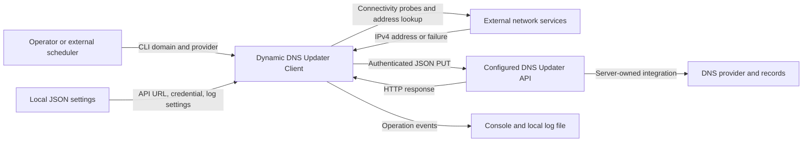
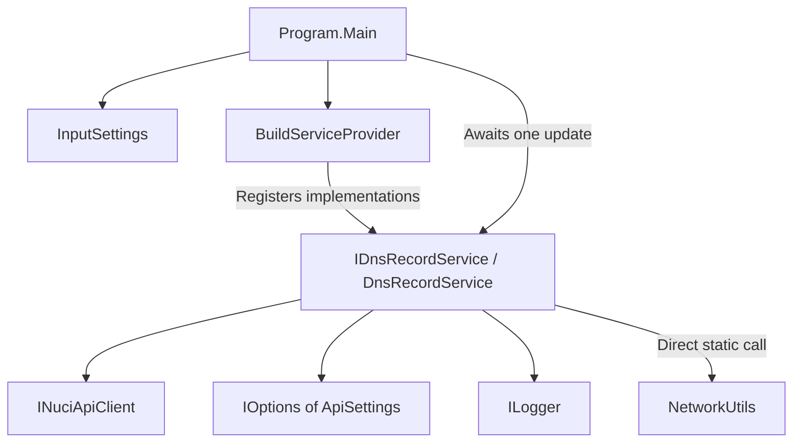
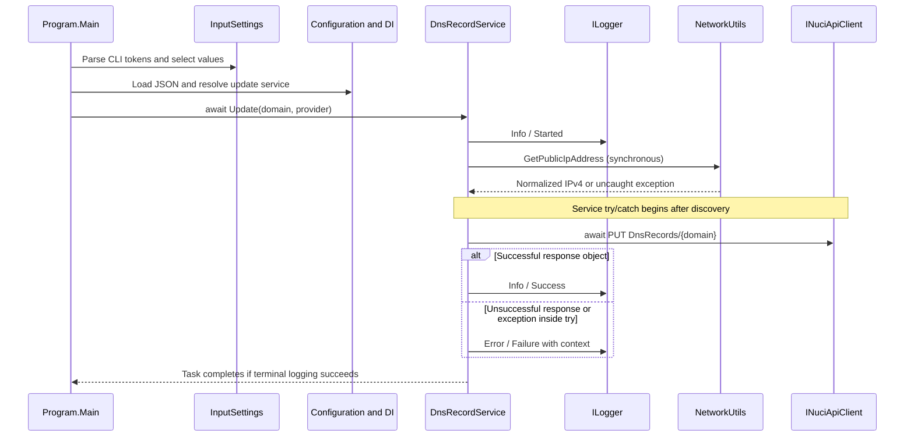
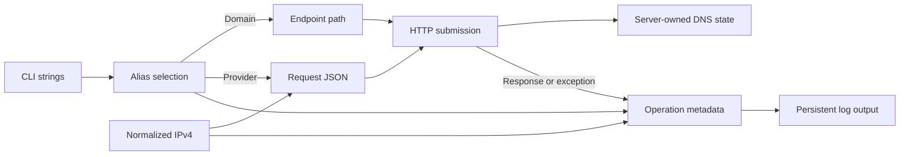
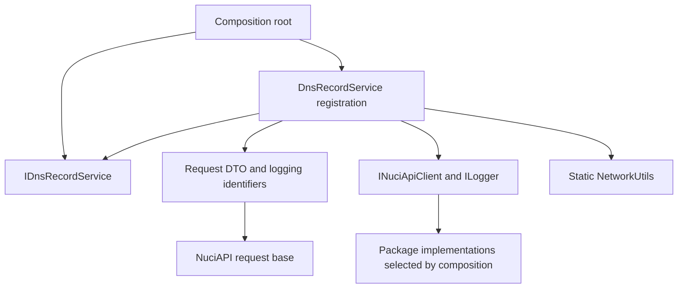

# Dynamic DNS Updater Client Architecture

This document describes the current .NET 10 command-line client, verified against repository implementation on 2026-10-24. It covers process boundaries, ownership, execution, contracts, and operational constraints; the external DNS Updater API and DNS providers are outside the implementation scope.

## 📑 Table of Contents

- [Table of Contents](#-table-of-contents)
- [Purpose](#-purpose)
- [System Context](#-system-context)
- [Architectural Style](#-architectural-style)
- [Runtime Flow](#-runtime-flow)
- [Components](#-components)
- [Data Architecture](#-data-architecture)
- [Interfaces and Integrations](#-interfaces-and-integrations)
- [Cross-Cutting Concerns](#-cross-cutting-concerns)
  - [Security and Privacy](#security-and-privacy)
  - [Error Handling](#error-handling)
  - [Observability](#observability)
  - [Configuration](#configuration)
  - [Concurrency and Resource Use](#concurrency-and-resource-use)
- [Dependency Direction and Rules](#-dependency-direction-and-rules)
- [External Dependencies](#-external-dependencies)
- [Deployment and Operations](#-deployment-and-operations)
- [Compatibility Contracts](#-compatibility-contracts)
- [Testing and Verification](#-testing-and-verification)
- [Design Constraints](#-design-constraints)
- [Extension Points](#-extension-points)
  - [Update Service Substitution](#update-service-substitution)
- [Architecture Decisions](#-architecture-decisions)
- [Source Map](#-source-map)
- [Related Documentation](#-related-documentation)

## 🎯 Purpose

The client submits one domain/provider update using a discovered public IPv4 address. It owns argument selection, configuration binding, request orchestration, and operation logging. It does not own provider credentials, domain authorization, DNS mutation, or propagation. These boundaries help contributors distinguish local compatibility obligations from unverified server behavior.

## 🌐 System Context

An operator or external scheduler launches the executable with domain/provider tokens and provisions local API settings. The process discovers an address through external network services, submits an authenticated request, and emits console/file logs. DNS state remains remote.



The principal external boundaries are:
- **Operator Input:** CLI values and local settings are trusted operational inputs, not validated domain or authorization evidence.
- **Address Discovery:** NuciWeb.HTTP owns external probes, fallback selection, IPv4 normalization, and a process-local cache.
- **DNS Updater API:** The configured server receives domain, provider, address, bearer credential, and client metadata; it owns authorization and DNS effects.
- **Filesystem and Console:** Configuration persists credentials, and default logging persists operation metadata. Operators own permissions and retention.

## 🏗️ Architectural Style

The implementation is a one-shot console pipeline with a manual dependency-injection composition root. A small service abstraction separates entry-point invocation from update orchestration. This is not a web host, continuously running worker, or layered persistence application.



The principal architecture boundaries are:
- **Composition:** [Program](./DynamicDnsUpdater.Client/Program.cs) selects implementations and lifetimes; it contains no provider-specific DNS logic.
- **Input Selection:** [InputSettings](./DynamicDnsUpdater.Client/Configuration/InputSettings.cs) delegates syntax to a package and applies local alias priority without business validation.
- **Update Orchestration:** [DnsRecordService](./DynamicDnsUpdater.Client/DnsRecordService.cs) combines discovery, request construction, and logging; the server owns mutation.
- **Package Adapters:** HTTP and logging are injected interfaces; discovery is a direct static dependency rather than an injectable adapter.

## 🔄 Runtime Flow



The principal runtime sequence is:
1. `DynamicDnsUpdater.Client.Program.Main` creates input settings before configuration or logging exists.
2. The composition root loads mandatory JSON, binds options, and resolves one update-service instance with its dependencies.
3. `DynamicDnsUpdater.Client.DnsRecordService.Update` logs Started, constructs authorization metadata, synchronously discovers IPv4, and creates the request.
4. Inside its try block, the service awaits one PUT. An unsuccessful response adds response fields and triggers a generic HTTP exception; the catch logs Failure without rethrowing.
5. A successful response produces Success logging. Main returns after the Task completes; there is no loop, explicit exit-code assignment, read-back, or provider verification.

Argument, configuration, service-resolution, Started-log, and discovery failures escape this request catch. Failure logging can also throw. The detailed [update flow](./docs/flows/dns-update.md) records alternate paths, including logging failure after a remote mutation.

## 🧩 Components

| Component | Responsibility | Principal Dependencies | Lifetime or Ownership |
|-----------|----------------|------------------------|-----------------------|
| `DynamicDnsUpdater.Client.Program` | Entry and container construction | Microsoft configuration, DI, options | Static provider/input references; no explicit provider disposal |
| `DynamicDnsUpdater.Client.Configuration.InputSettings` | Select domain/provider from parsed aliases | NuciCLI.Arguments | One input object per invocation |
| `DynamicDnsUpdater.Client.DnsRecordService` | Discover address, submit update, log outcome | API client, API options, logger, static NetworkUtils | Transient registration; resolved once by Main |
| `NuciAPI.Client.NuciApiClient` | HTTP URL, JSON, headers, response dispatch | System.Net.Http and package serialization | Singleton registration; captures base URL |
| `NuciLog.NuciLogger` | Console/file output | Bound logger-settings object, NuciLog.Core | Transient logger; singleton settings value |
| `NuciWeb.HTTP.NetworkUtils` | Connectivity and IPv4 discovery | External network services, shared client/cache | Package-owned static resources |

## 💾 Data Architecture

Domain/provider values remain verbatim after nonblank alias selection. The domain enters the endpoint path; provider and discovered IP enter JSON. Authorization is separate from the DTO. No local database, migration, last-address store, or durable update queue exists.



| Data or Store | Owner | Representation and Storage | Lifecycle or Consistency |
|---------------|-------|----------------------------|--------------------------|
| Input settings | Application | Read-only domain/provider strings in memory | Empty defaults; no domain/provider validation |
| API settings | Operator and options binding | JSON file and mutable bound strings | Plaintext credential; base URL captured by client construction |
| Request | Application DTO | JSON `ip` and `provider` string fields | No DTO validators; inherited HMAC token excluded from JSON |
| Address cache | NuciWeb.HTTP 1.7.3 | Process-local cached IPv4 | Two-minute expiry; not shared across executable runs |
| Logs | NuciLog/operator | Console plus default file append | No application rotation or retention policy |
| DNS records | Remote API/provider | External state | Not read back; logs and mutation are not atomic |

## 🔌 Interfaces and Integrations

| Interface or Integration | Direction | Contract | Owner | Failure Semantics |
|--------------------------|-----------|----------|-------|-------------------|
| CLI | Inbound | Double-hyphen option/value tokens | InputSettings and NuciCLI.Arguments | Parse errors escape before logging |
| `DynamicDnsUpdater.Client.IDnsRecordService.Update` | Internal | `Task Update(string domainName, string providerName)` | Application | No returned success flag or cancellation token |
| DNS API | Outbound | PUT `DnsRecords/{domain}` with JSON body and bearer metadata | Service and NuciAPI.Client | In-try errors logged/swallowed if logger succeeds; no retry |
| Public-IP lookup | Outbound | Package connectivity probes and shuffled lookup sources | NuciWeb.HTTP | Cached/fallback IPv4 discovery; exhausted lookup throws outside catch |
| Log output | Outbound | Structured operation fields via console/file | NuciLog | Synchronous I/O errors can change observable outcome |

There are no controllers or inbound HTTP endpoints. The API client creates client-ID, request-ID, and timestamp headers; the service does not log the generated request ID. HTTP status selects package success/error response types, whose success boolean is fixed by type. A 2xx body-level failure is not independently checked. See [integration details](./docs/integrations.md) for pinned package mechanics and unverified server contracts.

## 🧵 Cross-Cutting Concerns

### Security and Privacy

The API key comes from local JSON; no secret provider, local role model, or credential refresh exists. HTTPS is not enforced by application code. Domain input is interpolated without explicit path escaping. Machine name is included in client identity. Default logs retain domain/IP/base URL and failure text without explicit sensitive marking on custom keys. Operators must protect settings copies and logs. The root [security policy](./SECURITY.md) governs disclosure; [implementation security details](./docs/security.md) and [open questions](./docs/ambiguities-and-open-questions.md) distinguish code from contradictory privacy prose.

### Error Handling

Request failures caught by the service normally complete the Task rather than failing the process. Pre-try exceptions escape; error-log exceptions escape too. A Failure event does not prove the server made no change, and a Success event does not prove propagation. There is no rollback or automatic replay. See [failure taxonomy](./docs/error-handling.md).

### Observability

Info/Started, Info/Success, and Error/Failure identify `UpdateDnsRecord`. Context expands after discovery and on unsuccessful responses. NuciLog writes console output and, by default, synchronously appends to `logfile.log`. No metrics, health endpoint, dedicated audit sink, distributed trace, sampling, or application-managed retention exists. See [logging contracts](./docs/logging.md).

### Configuration

| Configuration Area | Source | Responsibility | Override or Secret Policy |
|--------------------|--------|----------------|---------------------------|
| Domain/provider | CLI tokens | Per-invocation update target | Fixed alias order; last duplicate wins within an alias |
| API settings | Mandatory [JSON](./DynamicDnsUpdater.Client/appsettings.json) | Base URL and bearer key | No environment/CLI configuration overlays; placeholders are literal |
| Logger settings | Same JSON plus package defaults | Output/filter/format settings | Extracted options value; file enabled by shipped settings |

JSON watching is enabled, but consumers use `IOptions<T>.Value`, not live monitoring; the client captures its URL at construction. Restart after configuration edits. Source settings are always copied to build output. See [configuration details](./docs/configuration.md).

### Concurrency and Resource Use

Main awaits one update. Discovery blocks synchronously before the HTTP await; the package performs internal concurrent connectivity probes. The API client is singleton, and discovery resources/cache are static. No application cancellation, end-to-end deadline, backpressure, or process lock exists. Overlapping invocations can submit competing updates and share a log-file destination without coordinated ordering. Provider and file-watcher resources are not explicitly disposed by Main.

## 🧭 Dependency Direction and Rules

The composition root knows concrete implementations. The executable invokes a service interface; the service consumes package interfaces/options, constructs its DTO, and calls static discovery. The server boundary is reached only through outbound HTTP, not local provider adapters.



The principal dependency rules are:
- Keep implementation selection in [Program](./DynamicDnsUpdater.Client/Program.cs); preserve the service signature when replacing its implementation.
- Keep provider-specific mutation and credentials on the server side of the existing HTTP boundary; no local provider subsystem exists.
- Treat CLI grammar, JSON names, endpoint shape, and catch placement as compatibility-sensitive, not incidental refactoring details.
- Do not assume the interface makes discovery injectable: its static call remains a concrete dependency requiring an explicit seam for isolated tests.

## 📦 External Dependencies

| Dependency | Responsibility | Integration Boundary | Architectural Consequence |
|------------|----------------|----------------------|---------------------------|
| Microsoft.Extensions 10.0.13 packages | JSON, DI, options | Composition root | Controls binding/lifetimes, not business validation |
| NuciCLI.Arguments 1.0.1 | Token parser | Input settings | Actual grammar requires `--`, despite internal short-alias spelling |
| NuciAPI 3.6.2 / NuciAPI.Client 1.2.4 | Request bases and HTTP envelopes | Update service | Package-owned serialization, headers, and HTTP-status dispatch |
| NuciWeb.HTTP 1.7.3 | Public-IP discovery | Static network call | IPv4-only discovery and additional external egress |
| NuciLog 1.2.1 / NuciLog.Core 3.1.0 | Structured logging and sinks | Logger interface | Persistent output and synchronous I/O failure paths |

Versions originate in [the application project](./DynamicDnsUpdater.Client/DynamicDnsUpdater.Client.csproj). [Dependency documentation](./docs/dependencies.md) records exact-tag upstream evidence and test-package versions; no default-branch assumptions are needed for these package behaviors.

## 🚀 Deployment and Operations

The deployment unit is a .NET 10 console executable plus configuration/dependencies. No container, service unit, production scheduler, database migration, or inbound listener is checked in. The process normally exits after one awaited update; automation must not equate exit success with DNS success.

| Concern | Current Design | Architectural Consequence |
|---------|----------------|---------------------------|
| Repetition | External invocation only | Operator supplies scheduling and overlap policy |
| Filesystem | Mandatory settings and optional file sink enabled by default | Launch/configure paths deliberately; protect copied credentials and logs |
| State/recovery | No checkpoint or local DNS history | Restart submits again; remote state may be unknown after failure |
| Scaling | Independent processes; no lock | No ordering or exact-once guarantee across concurrent invocations |
| CI | [Build workflow](./.github/workflows/dotnet.yml) restores, builds, tests on master push/PR | Verifies local tests, not live DNS behavior |
| Publication | [GitHub](./.github/workflows/github-release.yml) and [NuGet](./.github/workflows/nuget-release.yml) independently pack on release publication | Workflow presence does not prove successful distribution or installability |
| Release wrapper | [Script](./release.sh) downloads mutable upstream shell code | Inspect remote helper before execution; no local digest verification |

See [build and deployment](./docs/build-and-deployment.md) for permissions, package assumptions, and operational gaps.

## 🛡️ Compatibility Contracts

| Contract | Owner | Invariant | Verification | Change Policy |
|----------|-------|-----------|--------------|---------------|
| CLI selection | InputSettings/parser | Double-hyphen syntax, fixed alias priority, blank fallback, duplicate overwrite | [Input fixtures](./DynamicDnsUpdater.Client.UnitTests/Configuration/) | Explicitly review user-visible changes |
| Request JSON | DTO/server | `ip` and `provider`; no serialized inherited HMAC token | [DTO tests](./DynamicDnsUpdater.Client.UnitTests/Requests/PutDnsRecordRequestTests.cs) | Coordinate wire changes with server |
| Update method | Application | Two strings, Task return, no result/cancellation | [Interface](./DynamicDnsUpdater.Client/IDnsRecordService.cs); no service tests | Review callers and automation for result changes |
| Error boundary | Service/Main | Discovery outside try; caught request failures not rethrown | [Source](./DynamicDnsUpdater.Client/DnsRecordService.cs); coverage absent | Preserve unless intentionally changing exit/log behavior |
| HTTP route/auth | Client/server | PUT domain path, provider/IP body, bearer credential | Source and pinned dependency inspection; no transport tests | Validate server compatibility before altering |

## ✅ Testing and Verification

[The NUnit project](./DynamicDnsUpdater.Client.UnitTests/DynamicDnsUpdater.Client.UnitTests.csproj) verifies parsing/selection and direct System.Text.Json DTO behavior. The previous documentation investigation observed a successful SDK 10.0.112 build and 503 passing cases; that is a dated observation, not a claim of a new test run for this document.

Execute the principal automated verification with:

```bash
dotnet build DynamicDnsUpdater.Client.slnx
dotnet test DynamicDnsUpdater.Client.slnx --no-build
```

No service, composition, HTTP-wire, discovery, logging-I/O, exit-status, concurrent-invocation, or release-publication tests exist. DTO tests do not verify the API client's serializer end to end. Do not invoke production DNS updates as harmless checks; there is no dry-run. Authorized manual verification must inspect server/provider state and DNS resolution separately. See [testing boundaries](./docs/testing.md).

## ⚠️ Design Constraints

- **One-Shot Execution:** No watch loop, change detection, or built-in scheduler maintains ongoing synchronization.
- **External Authority:** Provider support, authorization, record types, idempotency, and propagation remain server-owned and unverified here.
- **Permissive Values:** Empty/unvalidated CLI values proceed; domain interpolation can affect URL interpretation.
- **Partial Error Propagation:** Normal completion is not a reliable update-success signal; logger failure can obscure mutation outcome.
- **Discovery Coupling:** IPv4 discovery is static, externally networked, and outside the request catch; no local family override exists.
- **Operational State:** Logs persist by default without rotation; configuration copies can persist credentials; no transactional relation exists between logs and DNS state.

## 🔧 Extension Points

### Update Service Substitution

1. Implement `DynamicDnsUpdater.Client.IDnsRecordService` from [the interface](./DynamicDnsUpdater.Client/IDnsRecordService.cs).
2. Replace the transient registration in [the composition root](./DynamicDnsUpdater.Client/Program.cs).
3. Add verification of request/result/error semantics and neighboring CLI/configuration contracts before changing operational behavior.

This is a code-level DI seam, not a runtime plugin system. The existing HTTP-client/logger interfaces can also be replaced at composition, while static discovery cannot. The current service contract exposes neither structured outcome nor cancellation.

## 📝 Architecture Decisions

No ADRs establish original author rationale. The rows record implemented choices and their functional role, not inferred historical intent.

| Decision | Rationale | Consequence | Record |
|----------|-----------|-------------|--------|
| Delegate DNS effects to remote API | Functional ownership: client submits target/address; server integrates providers | No local provider credentials or mutation implementation | [Service](./DynamicDnsUpdater.Client/DnsRecordService.cs) |
| Assign explicit request JSON names | Functional role: stable wire names independent of naming policy | DTO changes require server coordination | [Request](./DynamicDnsUpdater.Client/Requests/PutDnsRecordRequest.cs) and [tests](./DynamicDnsUpdater.Client.UnitTests/Requests/PutDnsRecordRequestTests.cs) |
| Resolve aliases in fixed order | Algorithmic rule directly encoded and tested | Across aliases, token order is not precedence | [InputSettings](./DynamicDnsUpdater.Client/Configuration/InputSettings.cs) |

See [design-decision analysis](./docs/design-decisions.md) for additional observed trade-offs with intent explicitly unverified.

## 🗺️ Source Map

| Area | Path |
|------|------|
| Solution and executable manifest | [Solution](./DynamicDnsUpdater.Client.slnx), [project](./DynamicDnsUpdater.Client/DynamicDnsUpdater.Client.csproj) |
| Entry/composition | [Program](./DynamicDnsUpdater.Client/Program.cs) |
| Orchestration/contract | [Service](./DynamicDnsUpdater.Client/DnsRecordService.cs), [interface](./DynamicDnsUpdater.Client/IDnsRecordService.cs) |
| Inputs and options | [Configuration](./DynamicDnsUpdater.Client/Configuration/), [JSON](./DynamicDnsUpdater.Client/appsettings.json) |
| Wire and operation metadata | [Requests](./DynamicDnsUpdater.Client/Requests/), [logging](./DynamicDnsUpdater.Client/Logging/) |
| Verification | [Unit tests](./DynamicDnsUpdater.Client.UnitTests/) |
| Delivery | [Workflows](./.github/workflows/), [release wrapper](./release.sh) |

## 📚 Related Documentation

- [README](./README.md): usage, development entry points, and project engagement.
- [Documentation Index](./docs/INDEX.md): complete knowledge-base catalogue and review metadata.
- [Runtime Architecture Notes](./docs/architecture.md): cross-boundary observations and detailed-flow navigation, complementary to this root overview.
- [Invariants](./docs/invariants.md) and [Change Guide](./docs/change-guide.md): compatibility obligations and modification impact sets.
- [Security Policy](./SECURITY.md) and [Privacy Policy](./PRIVACY.md): root policies, not implementation guarantees; [open questions](./docs/ambiguities-and-open-questions.md) records discrepancies.
- [License](./LICENSE): distribution terms.