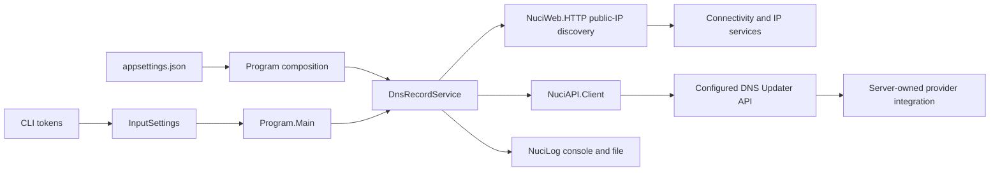

# Architecture

## Runtime Topology

One console process constructs a dependency-injection container, performs one update, then returns. It makes outbound network requests and writes logs. There is no inbound HTTP host or locally authoritative DNS state.

## Dependency Direction And Ownership

[Program](../DynamicDnsUpdater.Client/Program.cs) knows implementations to register them. Its business entry uses [the service interface](../DynamicDnsUpdater.Client/IDnsRecordService.cs). [The implementation](../DynamicDnsUpdater.Client/DnsRecordService.cs) depends on `NuciAPI.Client.INuciApiClient`, `Microsoft.Extensions.Options.IOptions<DynamicDnsUpdater.Client.Configuration.ApiSettings>`, `NuciLog.Core.ILogger`, and a direct static discovery call. The static discovery dependency is not replaceable through the container.

[The request model](../DynamicDnsUpdater.Client/Requests/PutDnsRecordRequest.cs) derives from a package request type. This inheritance contributes HMAC-related API surface but does not enable HMAC in this client. The service supplies only bearer token and client ID.

## State And Invariants

Inputs and settings are in-memory process state; the API key originates in a local JSON file. NuciWeb.HTTP adds a process-local discovery cache, while NuciLog persists log lines by default. The remote API owns DNS state. There is no local transaction tying logging to server mutation.

Preserve the distinction between four observations: parsing succeeded, discovery succeeded, the API client returned a success response type, and the DNS record actually propagated. Only the first three are visible locally, and only the third causes a Success operation log. See [Invariants](./invariants.md), [Errors](./error-handling.md), and [State](./state-and-persistence.md).

## Architectural Limits

No root architecture document existed at review; this document describes the implemented topology rather than duplicating one. No recorded ADR explains the original design. [Design Decisions](./design-decisions.md) separates observations from inferred benefits and costs.